# KICK 🍸 — Real-time serverless operations platform for bars & event venues

[](https://github.com/BenyHanonove/kick-showcase/actions/workflows/ci.yml)
[](https://www.typescriptlang.org/)
[](https://aws.amazon.com/)
[](https://sst.dev/)
[](https://vuejs.org/)

> Production operations system used by **2 paying venues** to run service nights end-to-end: shifts & clock-ins, cash registers & automated tip splitting, live inventory & consumption audits, staff task boards ("missions"), expense tracking, and closing PDF reports.
> Hebrew / RTL interface. Designed, built, deployed, and operated solo (2026).

<div align="center">
  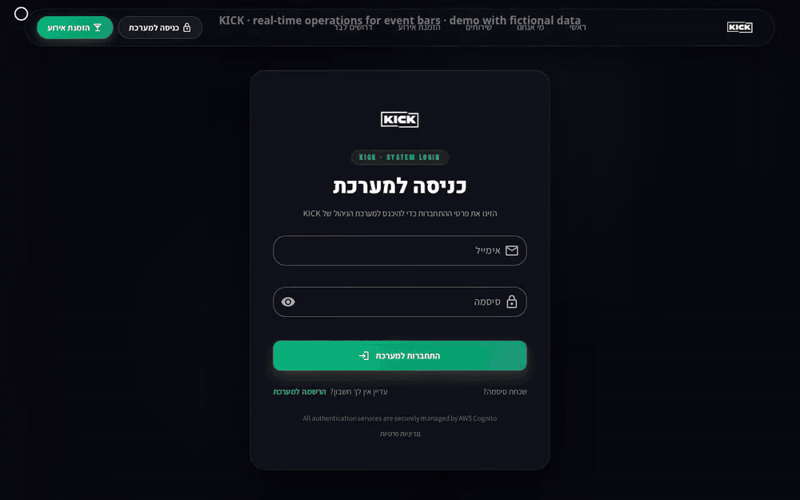
  <p><sub>Live demo recorded against the deterministic fixture harness (<a href="docs/demo.mp4">MP4 video</a> · reproduce locally with <code>npm run demo</code>)</sub></p>
</div>

---

## Highlights

- **Event-driven Change Data Capture (CDC)** — DynamoDB Streams feed 9 **EventBridge Pipes** into a central event bus; 18 observer Lambdas handle cascading deletes, cross-entity status sync, and side effects outside the request path, backed by per-subscriber SQS dead-letter queues and CloudWatch alarms.
- **Zero-account staff management via WhatsApp bot & ephemeral single-use tokens** — Field staff (bartenders, waiters, runners) never create user accounts or passwords. An automated WhatsApp Cloud API bot dispatches short-lived, cryptographically random single-use tokens (`TOKEN_TTL_HOURS = 24`, DynamoDB TTL) pointing to isolated public routes (`/shift/resolve`, `/shift/register`, `/employee/claim`) for onboarding, shift self-registration, and arrival/schedule notifications — consumed atomically via `TransactWriteCommand` so a link can never be replayed or double-spent.
- **Real-time fan-out without data leaks** — WebSocket broadcasts push only `{ action, id }` invalidation signals scoped to the active session room; clients refetch through role-guarded REST endpoints so authorization and field-level redaction stay in one place.
- **Concurrency & idempotency** — Optimistic locking (`timestamp` condition on every `UpdateCommand`, returning `409 Conflict` with automatic client diff/refetch), deterministic composite IDs (`deterministicId('shift-registration', sessionId, employeeId)`) preventing duplicate shift creation across concurrent tabs, and race-free versioned Redis caching (`version:<table>`).
- **Defense-in-depth security** — Short-lived access JWT kept in memory only + `HttpOnly; Secure; SameSite=None` refresh cookie, Cognito JWT verification on both HTTP API Gateway and WebSocket `$connect`, fail-closed `RolesGuard([Admin, Manager, Users])`, field-level financial redaction for non-admin roles, per-Lambda least-privilege IAM, and PII-redacting structured logs (AWS Lambda Powertools + X-Ray active tracing).
- **Verified across roles** — 307 frontend unit tests and 108 backend unit tests run on every push in GitHub Actions; black-box lifecycle suites execute against the `dev` stage as `Admin`, `Manager`, and `User` before any production deployment (`pipeline/deploy.js`).

---

## Architecture

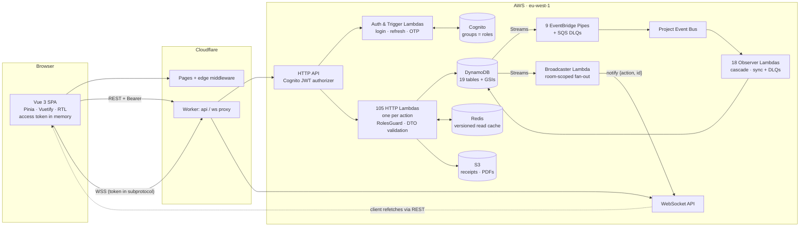

<details>
<summary><strong>High-resolution diagram & sequence flows (Optimistic Concurrency 409 · Notify-then-Refetch WebSocket · Ephemeral Token Bot Flow)</strong></summary>

<p align="center">
  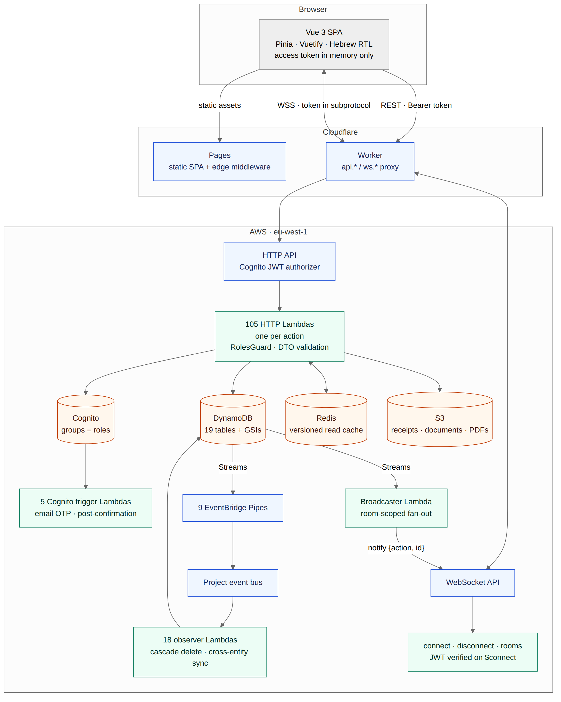
</p>

### Sequence 1: Concurrent edit → `409 Conflict` recovery

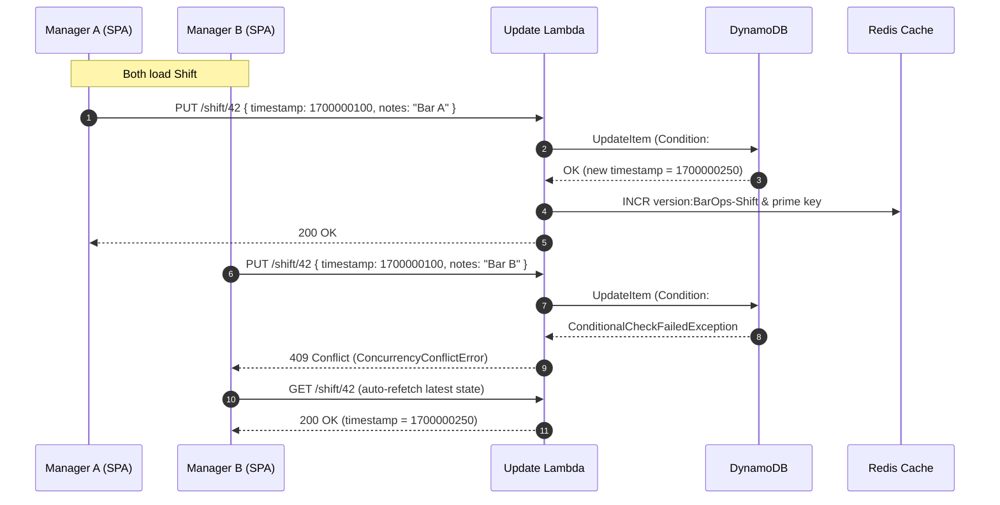

### Sequence 2: Write → DynamoDB Stream → WebSocket notify → Role-guarded refetch

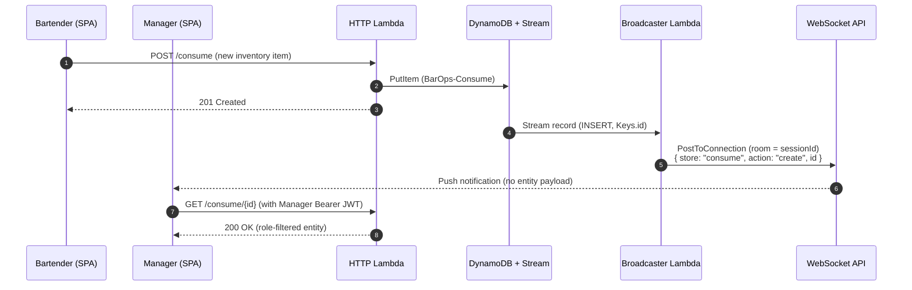

### Sequence 3: Accountless staff management via WhatsApp bot & single-use public token

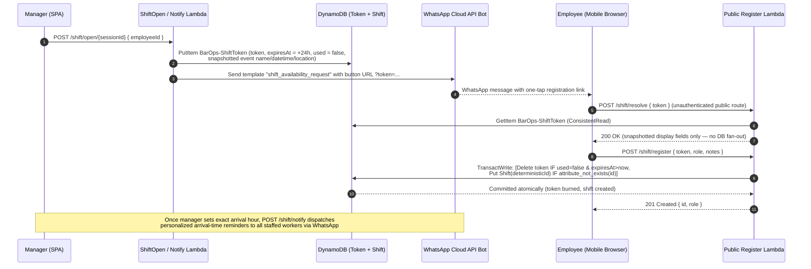

</details>

### Global Request Lifecycle (Standardized Across All 19 Modules)

Every domain module in the system follows the exact same end-to-end pipeline — from the Vue view down to DynamoDB, Redis, and EventBridge, with standardized error handling at every boundary:

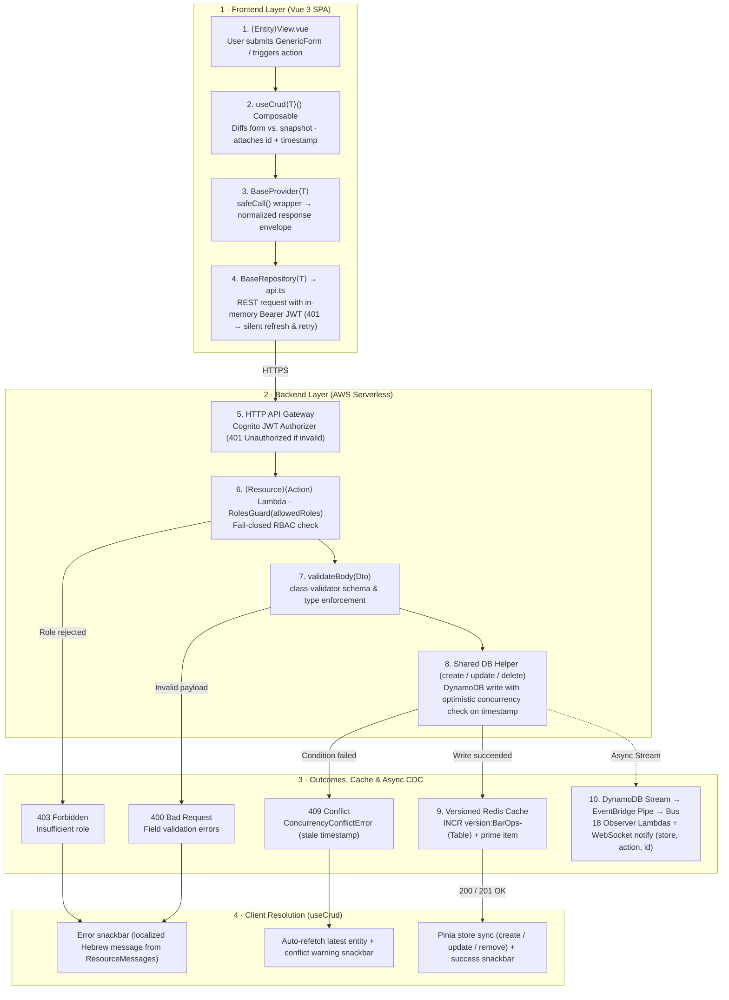

---

## Interface Screenshots

| Events List (Light) | Events List (Dark) |
| :---: | :---: |
| 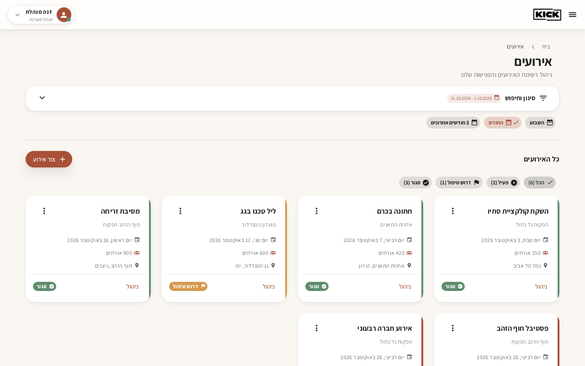 | 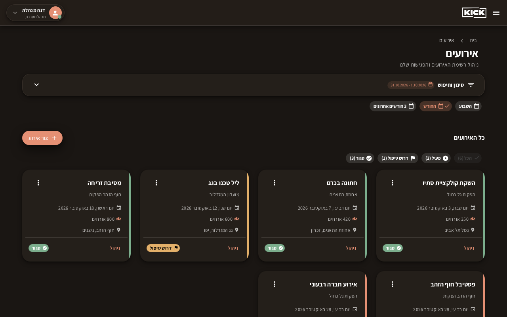 |
| **Event Summary & Closing** | **Shift Manager & Clock-ins** |
| 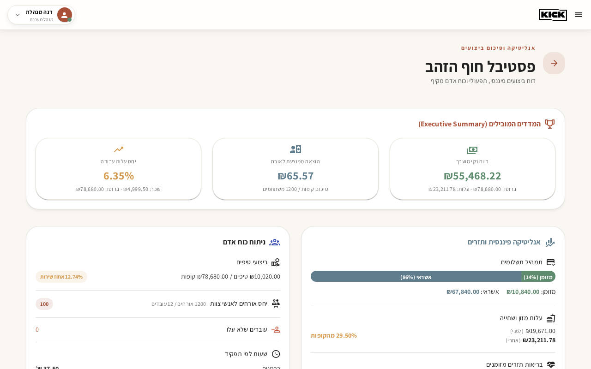 | 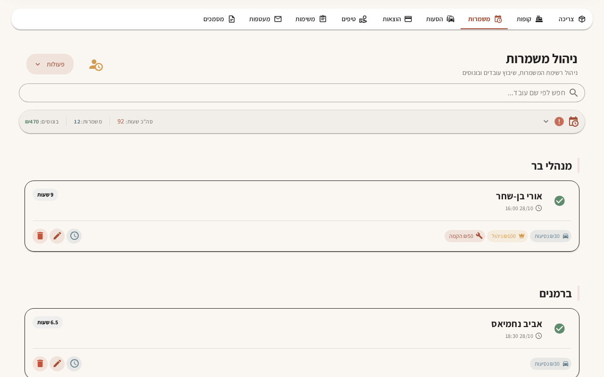 |
| **Tip Pool & Splits (Light)** | **Tip Pool & Splits (Dark)** |
| 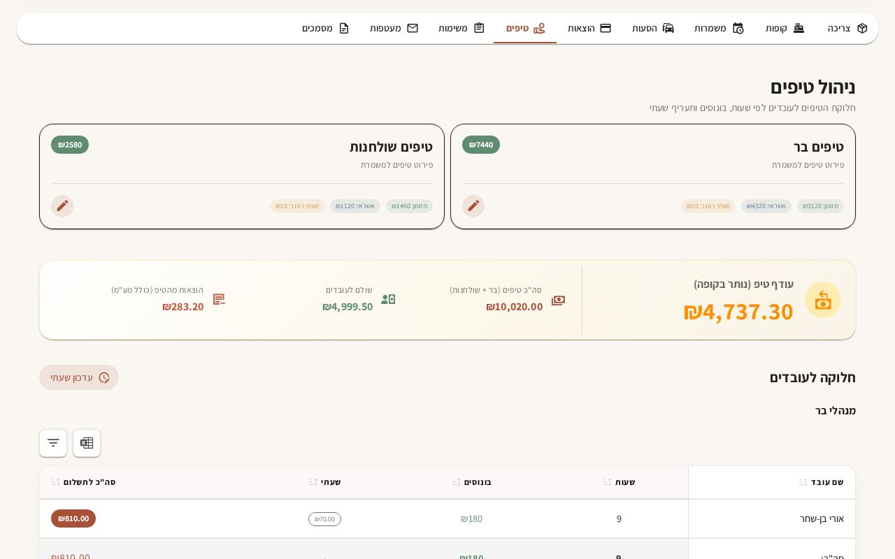 | 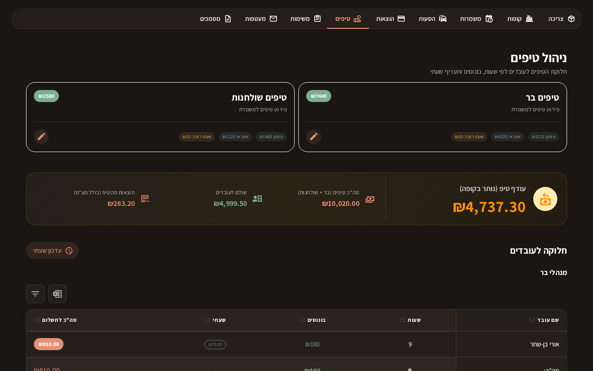 |

---

## Engineering Decisions & Trade-offs

| Decision | Why | Cost / Trade-off |
| --- | --- | --- |
| **Ephemeral single-use tokens over employee accounts** | Event staff rotate constantly across outdoor productions; forcing 100+ casual bartenders to manage Cognito credentials kills adoption. Automated WhatsApp bot links (`/shift/register`, `/employee/claim`) with short TTLs and `TransactWrite` burn-on-use give zero-friction UX and zero persistent attack surface | Requires dedicated token tables (`BarOps-ShiftToken`, `BarOps-EmployeeToken`), snapshotting display metadata onto the token row so public `resolve` routes cannot enumerate core tables, and strict `TransactWrite` conditions against double-submit |
| **DynamoDB over PostgreSQL** | Known access patterns (by `id`, `sessionId`, `monthYear`), native Change Data Capture via Streams, near-zero idle cost on pay-per-request | Ad-hoc cross-table analytics require export or in-memory aggregation; `list()` paginates via `LastEvaluatedKey` |
| **One Lambda per action** | Strict per-function IAM least privilege, isolated cold-start blast radius, independent CloudWatch metrics per endpoint | ~130 functions to manage in IaC (solved with declarative factory helpers in `infrastructure/`) |
| **Notify-then-refetch WebSockets** | WebSocket frame carries only `{ store, action, id }`; authorization and manager field redaction remain in the HTTP handlers | $N$ connected clients in the room issue a `GET /<resource>/:id` (served from the versioned Redis cache after the first read) |
| **Versioned Redis cache keys** | `get:<table>:<version>:<id>` + `INCR version:<table>` gives $O(1)$ invalidation without `SCAN`/`KEYS` or read-modify-write races | Table-level granularity: any write to a table advances the version for all cached items of that table |
| **Single-tenant per deployment** | Simplifies data model and keeps blast radius isolated per venue company; near-zero fixed overhead per serverless stage | Multi-company SaaS requires either per-tenant stages (silo) or composite `tenantId#id` keys (see [`architecture/multi-tenancy.md`](architecture/multi-tenancy.md)) |

---

## Infrastructure as Code & Production Status

All AWS resources — **19 DynamoDB tables** (with GSIs, Streams, and TTL), the **HTTP API Gateway** (routes, integrations, JWT authorizer, CORS), the **WebSocket API**, **Cognito User Pools** (with per-stage isolation for non-production stages), **EventBridge Pipes**, **SQS Dead-Letter Queues**, **X-Ray active tracing**, and **CloudWatch Alarms** — are declared in SST v4 / Pulumi under [`bar-ops-api-v3/infrastructure/`](bar-ops-api-v3/infrastructure/).

- **Fresh stages (`IMPORT_EXISTING=false`):** `npx sst deploy --stage <name>` provisions an isolated stack from scratch, including a dedicated Cognito user pool and `<stage>-BarOps-*` tables.
- **Adopting existing console resources (`IMPORT_EXISTING=true`):** Uses Pulumi's `import` option with `protect: true` and `retainOnDelete: true` so existing production tables and API Gateways are adopted into state without replacement. Full runbook: [`architecture/infrastructure-as-code.md`](architecture/infrastructure-as-code.md).

---

## Repository Layout

| Path | Description |
| --- | --- |
| [`bar-ops-api-v3/infrastructure/`](bar-ops-api-v3/infrastructure/) | SST v4 / Pulumi IaC modules: tables, HTTP & WebSocket APIs, Cognito, Pipes, DLQs, CloudWatch alarms |
| [`bar-ops-api-v3/packages/functions/`](bar-ops-api-v3/packages/functions/) | Lambda handlers (`<resource>/<action>/index.ts`), EventBridge observers, Cognito triggers, WebSocket handlers |
| [`bar-ops-api-v3/packages/shared/`](bar-ops-api-v3/packages/shared/) | Shared core: DynamoDB helpers (`create`/`get`/`list`/`update`/`delete`), versioned Redis client, `RolesGuard`, DTOs (`class-validator`), Powertools logger & tracer |
| [`bar-ops-api-v3/packages/testing/`](bar-ops-api-v3/packages/testing/) | Role-matrix black-box integration tests (`Admin` / `Manager` / `User`) and gated deploy pipeline |
| [`bar-ops-api-v3/tests/`](bar-ops-api-v3/tests/) | Offline Vitest unit test suites (OCC `409`, pagination >1MB, versioned cache, `RolesGuard`, idempotency, utilities) |
| [`bar-ops-dashboard/src/modules/`](bar-ops-api-v3/../bar-ops-dashboard/src/modules/) | Vue 3 domain modules (`session`, `shift`, `cashier`, `tips`, `sale`, `consume`, `mission`, `employee`, etc.) following `view → composable → provider → repository` |
| [`bar-ops-dashboard/demo/`](bar-ops-dashboard/demo/) | Playwright mock-API harness that runs the real SPA against deterministic fictional data to record the demo GIF and screenshots |
| [`cloudflare/api-proxy/`](cloudflare/api-proxy/) | Cloudflare Worker proxying REST and WebSocket traffic on custom domains |
| [`architecture/`](architecture/) | System map, backend & frontend golden paths, [IaC adoption guide](architecture/infrastructure-as-code.md), [multi-tenancy analysis](architecture/multi-tenancy.md), and [AI workflow contract](architecture/AI-WORKFLOW.md) |

---

## Running Locally

### 1. Frontend Dashboard (`bar-ops-dashboard`)

```bash
cd bar-ops-dashboard
cp .env.example .env.local
npm ci

# Run unit tests (307 tests), type-check, and linter
npm test
npm run type-check
npm run lint

# Launch the interactive demo with deterministic mock data (no AWS credentials needed)
npm run demo
```

### 2. Backend API (`bar-ops-api-v3`)

```bash
cd bar-ops-api-v3
cp .env.example .env.dev
npm ci --ignore-scripts

# Run Lambda & shared-core typecheck and unit tests (108 tests, offline mocks)
npm run typecheck
npm test
```

---

## How I Work with AI Agents

AI coding agents are used on this repository as a pair of hands governed by an explicit architecture contract — never as an autonomous author. Every session starts by reading [`architecture/README.md`](architecture/README.md) (the 7 system invariants and layer checklists) and [`architecture/AI-WORKFLOW.md`](architecture/AI-WORKFLOW.md), plans file-by-file before writing code, and is gated by strict TypeScript checks, ESLint, and unit + role-matrix test suites before commit.

---

## License

Copyright © 2026 Benjamin Hanonove. All rights reserved — shared publicly for portfolio review only. See [LICENSE](LICENSE).
