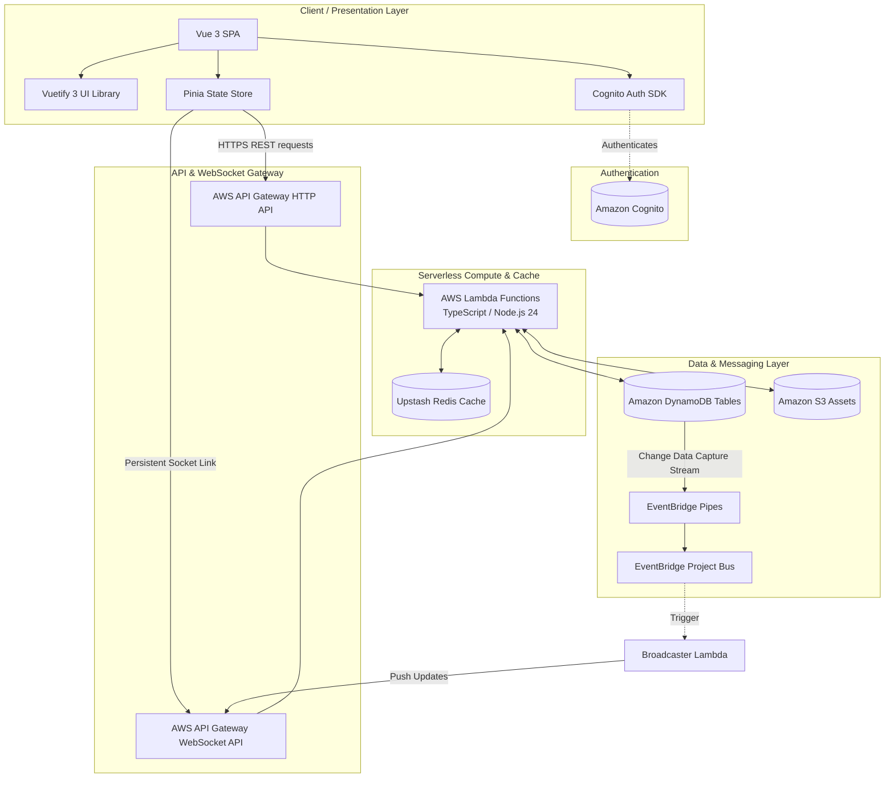

# BarOps 🍸

[](https://sst.dev/)
[](https://vuejs.org/)
[](https://www.typescriptlang.org/)
[](https://aws.amazon.com/)

> **BarOps** is a real-time, event-driven serverless operations management system designed to streamline shift scheduling, cashier registers, tip splitting, employee task delegation (missions), and live inventory/sales tracking for busy nightlife and bar venues.

---

## 📱 Interface Preview

*To showcase the project to interviewers, capture a screen recording or GIF of the web application in action and save it as `/docs/dashboard-preview.gif` to replace the placeholder below.*

<div align="center">
  
  
  *Real-time dashboard interface built with Vue 3, Vuetify, and Pinia*
</div>

---

## ⚡ Core Features

- **Shift & Session Tracking**: Real-time management of active operational sessions, shifts, and employee clock-ins.
- **Tip Splitting & Cashier Auditing**: Automatic tip pool calculations, and cashier register logs for auditing shift revenues.
- **Missions & Task Delegation**: Real-time task board ("missions") where managers assign checklist items to staff members.
- **Inventory & Consumption Audits**: Track stock levels, ingredient consume rates, and product sales.
- **Real-Time Data Sync**: WebSocket connections push immediate database changes (sales, shifts, tasks) to all active dashboards.
- **Event-Driven Architecture**: Uses DynamoDB streams and Amazon EventBridge Pipes to route background updates asynchronously.

---

## 🏗️ Architecture Diagram

BarOps is split into a **Vite/Vue 3 Single Page Application** frontend and an **SST v4 / Pulumi-managed TypeScript serverless backend** deployed on AWS. 



### Key Architectural Patterns
1. **Change Data Capture (CDC)**: Tables (like Supplier, Shift, tips, etc.) have DynamoDB Streams enabled. When changes occur, **EventBridge Pipes** capture the stream and forward events to a central Event Bus (`ProjectBus`).
2. **Reactive Orchestration**: Modules subscribe to specific events on the `ProjectBus`. For example, deleting a supplier triggers the `ProductObserverRule` to automatically remove related products.
3. **Real-time Synchronization**: The `SocketsBroadcaster` Lambda listens for DB changes, scans active socket connections in `WebSocketConnections`, and broadcasts live state updates to clients.

---

## 📂 Project Structure

```bash
BarOps/
├── bar-ops-dashboard/         # Frontend single page application
│   ├── src/
│   │   ├── modules/           # Feature modules (auth, shift, sale, etc.)
│   │   └── App.vue
│   ├── package.json
│   └── vite.config.ts
├── bar-ops-api-v3/            # Backend serverless API (SST v4 / Pulumi)
│   ├── infrastructure/        # Pulumi/SST infrastructure definitions
│   ├── packages/
│   │   ├── functions/         # Lambda handlers (REST endpoints, sockets)
│   │   └── shared/            # Shared DTOs, guards, validation, and utilities
│   ├── package.json
│   └── sst.config.ts
└── testing/                   # Integration and user journey test scripts
```
