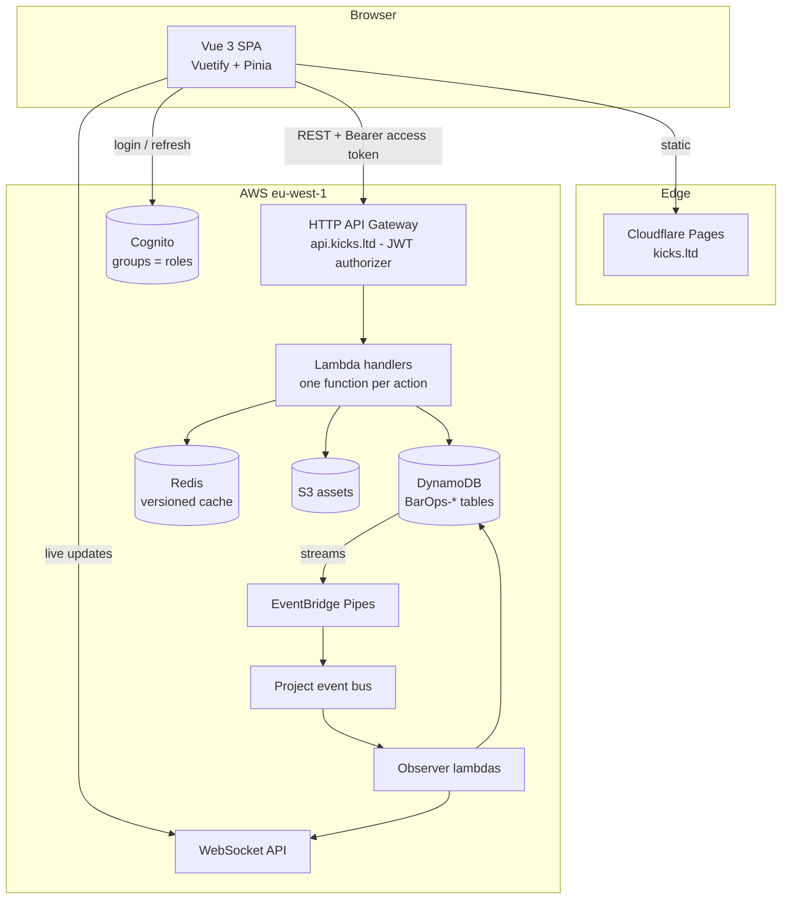

# KICK 🍸 — Architecture Guide

This folder is the map of how this system is built, so a new feature is a **copy of an
existing path**, not a design exercise. Every document here describes what the code
*actually does today* (verified against the source on 2026-09-04), not an aspiration.

| I want to… | Read |
| --- | --- |
| Start a chat with any AI agent on this repo | [AI-WORKFLOW.md](AI-WORKFLOW.md) — how agents are used here, and the prompt each one starts with |
| Add a new API resource (table + endpoints) | [backend/README.md](backend/README.md) → *Golden path* |
| Add a new screen / module in the dashboard | [frontend/README.md](frontend/README.md) → *Golden path* |
| Understand one layer in depth | The numbered files inside [backend/](backend/) and [frontend/](frontend/) |

---

## 1. The system in one picture



## 2. Repo layout

| Path | What lives there |
| --- | --- |
| [`bar-ops-api-v3/`](../bar-ops-api-v3/) | Serverless backend — SST v4 + Pulumi, TypeScript Lambdas |
| [`bar-ops-api-v3/packages/functions/`](../bar-ops-api-v3/packages/functions/) | One folder per resource, one folder per action, one `index.ts` = one Lambda |
| [`bar-ops-api-v3/packages/shared/`](../bar-ops-api-v3/packages/shared/) | DTOs, data-access helpers, guards, utils — everything reusable |
| [`bar-ops-api-v3/packages/testing/`](../bar-ops-api-v3/packages/testing/) | Black-box API tests + the deploy pipeline |
| [`bar-ops-api-v3/infrastructure/`](../bar-ops-api-v3/infrastructure/) | One `*.infrastructure.ts` per resource — Lambda definitions + IAM |
| [`bar-ops-dashboard/`](../bar-ops-dashboard/) | Vue 3 SPA (Vite, Vuetify 3, Pinia), Hebrew/RTL |
| [`bar-ops-dashboard/src/modules/`](../bar-ops-dashboard/src/modules/) | One folder per domain, each a full vertical slice |
| [`bar-ops-dashboard/src/config/`](../bar-ops-dashboard/src/config/) | Router, Pinia root, theme, env |
| [`bar-ops-dashboard/functions/`](../bar-ops-dashboard/functions/) | Cloudflare Pages edge middleware (per-route link previews) |

**Naming:** the user-facing brand is **KICK 🍸**. Internal resources keep the
historical `BarOps-*` prefix (tables, app name, protocol names) — never rename them.

## 3. One request, end to end

A manager edits a client name. This is the full trace — every layer you will ever touch:

```
ClientView.vue                     user clicks "עדכן", edits, submits GenericForm
 └─ useClientCrud().handleUpdate   diffs form vs. snapshot, attaches id + timestamp
     └─ clientProvider.update      safeCall → {success, message, data, statusCode}
         └─ clientRepository       BaseRepository.update → PUT /client/:id
             └─ api.ts             axios: Bearer access token, 401 → refresh + retry
─────────────────────────────────── network ───────────────────────────────────
API Gateway                        JWT authorizer validates the Cognito token
 └─ ClientUpdate lambda            RolesGuard([ADMIN]) → 403 if role too low
     └─ validateBody(UpdateClientDto)  class-validator, 400 on failure
         └─ update() helper        DynamoDB conditional write on `timestamp`
             ├─ conflict → 409     ConcurrencyConflictError
             └─ ok → Redis version bump + cache prime
                 └─ DynamoDB stream → Pipe → bus → observers → WebSocket broadcast
─────────────────────────────────── response ──────────────────────────────────
useCrud                            409 → refetch + warning snackbar
                                   200 → store.update(entity) + success snackbar
```

## 4. The invariants that make new features fast

These are the rules the whole codebase already follows. Break one and you lose the
copy-paste path.

1. **One Lambda = one action.** `packages/functions/<resource>/<action>/index.ts`.
   No routers, no switch statements inside a function.
2. **DTOs are the single source of truth.** The frontend `I*` interfaces mirror the
   backend DTOs field for field — see [Interface–DTO alignment](frontend/03-types.md).
3. **Every update is optimistic-concurrency checked** by `timestamp`. `IUpdate*` /
   `Update*Dto` always carry `timestamp`, and a 409 means "reload and retry".
4. **Authorization is declarative** — `RolesGuard([UserRole.ADMIN])` on the backend,
   `meta.minRole` + `isAdmin` computed on the frontend. Never inline role strings.
5. **Reads go through the cache helpers**, which are invalidated by bumping
   `version:<table>` in Redis. Never call `docClient` directly from a handler.
6. **The frontend never talks to axios directly** — always
   view → composable → provider → repository → `api.ts`.
7. **User-facing strings are Hebrew** and come from `ResourceMessages` (backend) or
   the composable/view (frontend).

## 5. Infrastructure as code & tenancy

- **IaC (`bar-ops-api-v3/infrastructure/`):** DynamoDB tables, the HTTP and WebSocket API Gateways, the EventBridge bus, Cognito pools, DLQs, X-Ray tracing, and CloudWatch alarms are declared in SST/Pulumi with `import` support for adopting the existing console-created production resources. See [infrastructure-as-code.md](infrastructure-as-code.md) for the stage model and one-time import procedure.
- **Tenancy:** Each deployment is single-tenant by design (clients are rows in `BarOps-Client`, not tenants). See [multi-tenancy.md](multi-tenancy.md) for the silo vs. pooled multi-tenant design notes.

## 6. Health snapshot

CI is the source of truth: [`.github/workflows/ci.yml`](../.github/workflows/ci.yml)
runs on every push and pull request.

| Job | Steps |
| --- | --- |
| `dashboard` | `npm ci` → `npm run type-check` (vue-tsc) → `npm run lint` → `npm test` (Vitest) |
| `api` | `npm ci --ignore-scripts` → `npm run typecheck` (tsc, Lambda code only) → `npm test` (Vitest) |

The black-box API suites in [`packages/testing/`](../bar-ops-api-v3/packages/testing/)
need a deployed stage and Cognito test users, so they run in the deploy pipeline
(`npm run deploy:barops`: deploy dev → clean → test as each role → deploy production),
not in public CI. Known operational notes: `quotation.js` is skipped in the API test
suite (model not in use), and `/employee/notify` has no API Gateway route yet.
